# DeepSeek Chat · Android



简体中文 | [English](README.en.md)

基于 [DeepSeek 官方 chat-demo](https://github.com/deepseek-ai/chat-demo) v0.1.1 的安卓适配项目。使用 React、TypeScript 和 Capacitor 6，将静态聊天应用打包为可安装的 APK。应用直接连接配置的 API 服务，API Key 由使用者在应用中填写。

本仓库维护安卓封装及界面适配，开发分支为 `ui-optimize`。应用名称为 **DeepSeek Chat**，包名为 `com.example.chatdemo`。当前交付使用 debug 签名，适合自行侧载测试。

## 当前进展

- 官方简洁界面，支持浅色、深色及跟随系统主题。
- 安卓返回键依次关闭设置、侧边抽屉和搜索面板，再退出应用。
- 状态栏颜色同步、发送与打开抽屉的触感反馈、减少动态效果适配。
- 触屏设备直接显示历史消息操作按钮。
- Harness 风格桌面图标，冷启动使用纯白背景、居中鲸鱼及无标题栏过渡。

2026-11-19，`7dc302a` 已通过云端 APK 构建，使用者反馈冷启动显示问题已解决。该反馈仅覆盖本次冷启动问题，其他功能和不同设备的验证进度见 [版本记录](CHANGELOG.md)。

## 获取 APK

1. 打开 [Build Android APK 的 Actions 记录](https://github.com/asceticmonkplus789-hash/DeepSeek-Chat-Android/actions/workflows/build-apk.yml)。
2. 选择目标提交对应的绿色运行。冷启动修复版为 `7dc302a`。
3. 在运行底部的 **Artifacts** 下载 `chatdemo-debug-apk`，解压取得 `app-debug.apk`。
4. 传到安卓手机，按系统提示允许对应来源安装。

下载 Actions artifact 通常需要登录 GitHub。可下载期限以运行页面为准。上游的在线演示与 Releases 对应上游网页版本，本仓库安卓 APK 通过上述构建产物获取。

**更新前请先备份。** 当前云端没有配置持久化签名密钥，已交付的不同构建证书不同，安卓通常会拒绝覆盖安装。先导出聊天历史，单独保存 API Key、设置和重要附件原件，确认备份后再决定卸载旧版。卸载会清除应用本地数据。后续稳定更新需要持续使用同一签名密钥。

## 首次使用

进入设置的数据管理，输入自己的 DeepSeek API Key，再开始聊天。API 请求使用该 Key，费用与服务能力以所使用的 API 服务为准。

现有聊天功能包括多会话与消息分支、流式回答、深度思考、智能搜索、链接引用、附件、语音输入与朗读，以及 Markdown、代码高亮、KaTeX 和 Mermaid 展示。搜索、文件、语音等功能依赖相应服务端接口支持，需分别验证。

## 数据与备份

API Key 和设置存于 localStorage，会话与附件原件存于 IndexedDB。聊天、上传和语音请求会将相应内容发送到配置的 API 服务。

历史导出包含会话与本地可用的图片原件。API Key、应用设置和非图片附件原件需要单独保存。导入在确认和校验成功后替换本地会话与附件。详细范围见 [数据与安全说明](docs/DATA.md) 和 [历史归档格式](src/services/chat/history/README.md)。

## 本地开发

已验证的本地环境为 Node.js 24.21.0、pnpm 9.15.9。现有 CI 使用 Node.js 20、pnpm 9 和 JDK 17。

```sh
git clone --branch ui-optimize https://github.com/asceticmonkplus789-hash/DeepSeek-Chat-Android.git
cd DeepSeek-Chat-Android
npx pnpm@9.15.9 install --frozen-lockfile
npx pnpm@9.15.9 dev
```

打开 http://localhost:8090 。开发、Windows 构建、安卓生成目录与冷启动补丁的顺序见 [开发与构建指引](docs/DEVELOPMENT.md)。

## 工程导航

| 位置 | 用途 |
|---|---|
| `src/` | 聊天网页源码、状态和本地数据管理 |
| `android-wrap/` | Capacitor 配置、应用素材和安卓生成补丁 |
| `.github/workflows/build-apk.yml` | 从源码构建网页和 debug APK |
| `docs/DEVELOPMENT.md` | 开发、构建和手机验收 |
| `docs/DATA.md` | 数据保存、导入导出和问题反馈 |
| `CHANGELOG.md` | 安卓适配版本与验证记录 |
| `THIRD_PARTY_NOTICES.md` | 上游、图标来源及依赖说明 |

`main` 保留早期静态产物封装版本，`v0.1.1` 保留初版归档。本仓库的旧版标签与上游同名源码标签含义不同。

## 来源与许可

网页源码来自 DeepSeek chat-demo。图标及冷启动鲸鱼形状参考 [DeepSeek Harness](https://github.com/deepseek-ai/deepseek-harness)，本仓库为个人安卓适配项目。来源版本、素材链接与第三方说明见 [THIRD_PARTY_NOTICES.md](THIRD_PARTY_NOTICES.md)。

源码沿用 [MIT License](LICENSE)，保留上游版权信息。分发网页或 APK 时应保留相关许可和第三方说明。
